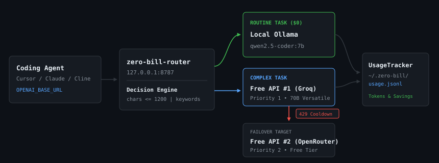
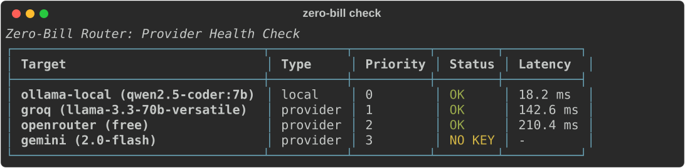
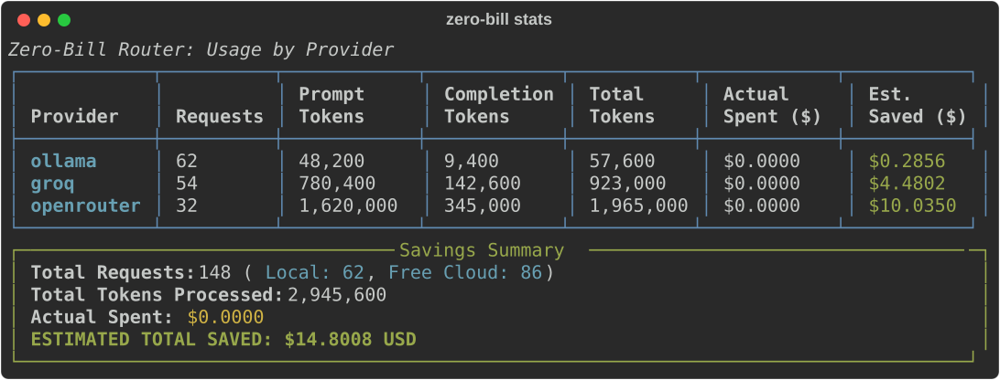

# zero-bill-router

Cut your coding-agent API bill to $0 with automatic free-tier failover and local Ollama routing.

[](https://www.python.org/)
[](LICENSE)
[](https://platform.openai.com/docs/api-reference)
[](https://github.com/an1zy/zero-bill-router)



`zero-bill-router` is a local OpenAI-compatible proxy server for coding assistants (Cursor, Cline, Claude Code, Codex, Gemini CLI). It transparently dispatches requests between local Ollama instances and free-tier cloud providers (Groq, OpenRouter Free, Google AI Studio) with automatic rate-limit failover.

---

## Quick Start

### Option A: CLI Installation

```bash
git clone https://github.com/an1zy/zero-bill-router.git
cd zero-bill-router
pip install -e .

# Initialize config, check provider connectivity, and start daemon
zero-bill init
zero-bill check
zero-bill serve
```

### Option B: Agent Skill Installation

Install into your agent runtime:

```bash
npx skills add an1zy/zero-bill-router
```

---

## Connect Your Coding Agent

Configure your coding assistant to use `http://127.0.0.1:8787/v1` with model `zero-bill-auto`:

### Cursor
- Settings -> Models -> OpenAI API Key
- Override Base URL: `http://127.0.0.1:8787/v1`
- API Key: `zero-bill`
- Model: `zero-bill-auto`

### Cline
- Settings -> API Provider: OpenAI Compatible
- Base URL: `http://127.0.0.1:8787/v1`
- API Key: `zero-bill`
- Model ID: `zero-bill-auto`

### Claude Code / Environment
```bash
export OPENAI_BASE_URL="http://127.0.0.1:8787/v1"
export OPENAI_API_KEY="zero-bill"
```

---

## CLI Diagnostics

### Provider Health Check
```bash
zero-bill check
```


### Usage & Savings Report
```bash
zero-bill stats
```


---

## How Routing & Failover Work

1. **Local Evaluation**:
   - `local_keywords`: Prompts containing routine terms (`commit message`, `summarize`, `rename`, `format`, `typo`, `docstring`) route to local Ollama.
   - `local_max_chars`: Requests under 1,200 characters route locally to conserve cloud quotas.
2. **Cloud Cascading**:
   - Complex tasks dispatch to free-tier cloud providers sorted by priority (`Groq` -> `OpenRouter` -> `Gemini`).
3. **Rate-Limit Failover**:
   - On HTTP 429, 5xx, or timeout, the router flags the provider in cooldown (default: 60s) and fails over to the next candidate.
4. **Response Metadata**:
   - Non-streaming responses include the header `X-ZeroBill-Provider` showing which target handled the request.

---

## License

MIT. See [LICENSE](LICENSE).
